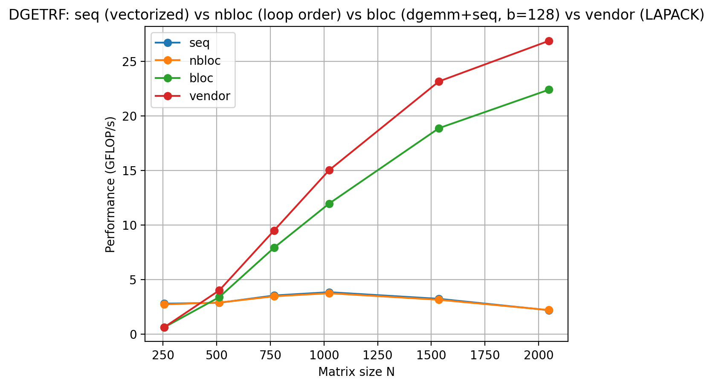
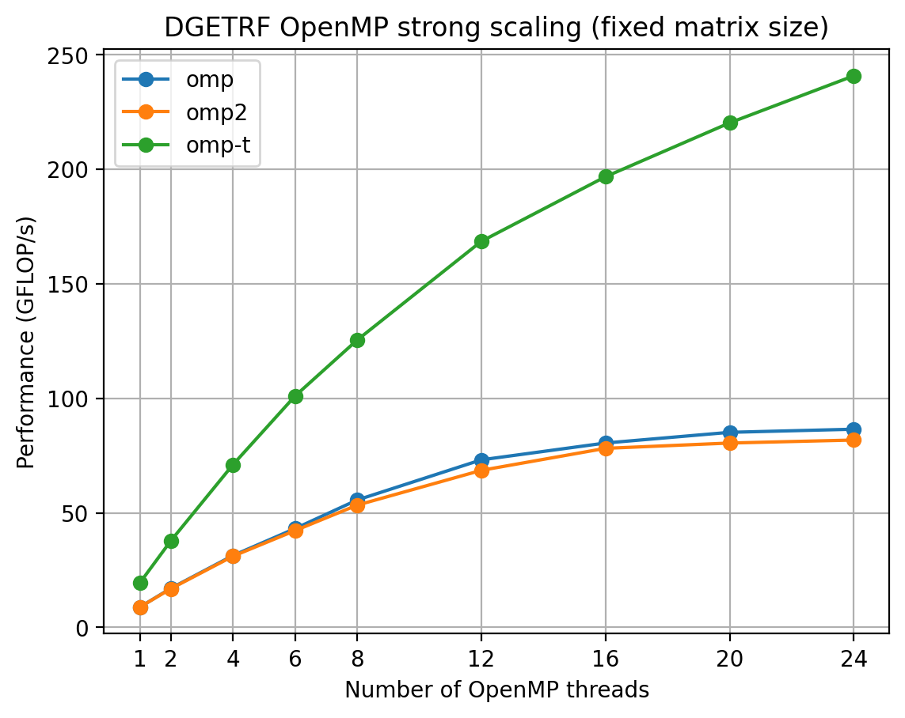
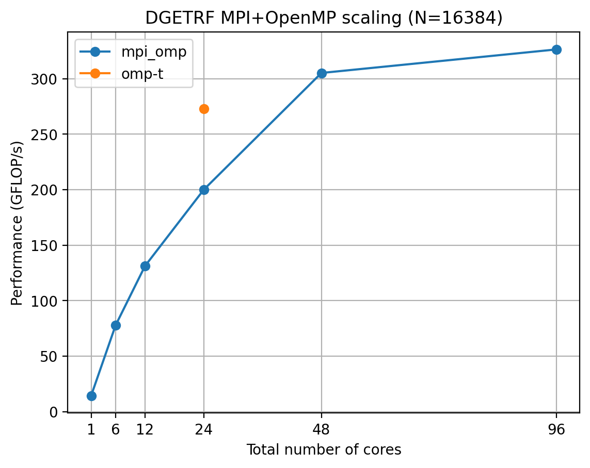

# Dense LU & GEMM kernels

Hand-optimized dense linear algebra kernels in C: LU factorization (`dgetrf`, no pivoting) and matrix multiplication (`dgemm`), taken from a naive triple loop up to AVX2 micro-kernels, OpenMP task graphs and hybrid MPI+OpenMP. They were benchmarked on up to 96 cores of an HPC cluster.

HPC course project at ENSEIRB-MATMECA (Bordeaux INP), 2025-2026.

## Authors

Arthur Dufetrelle, together with a fellow ENSEIRB-MATMECA student.

## What's inside

The kernels plug into [mini-chameleon](https://gitlab.inria.fr/solverstack/mini-examples/mini-chameleon), a teaching framework that handles matrix generation, validation (`check_*`) and timing (`perf_*`). The framework is **not** included in this repository (see [Credits](#credits)): `setup.sh` downloads it and installs the kernels on top.

```
kernels/    our kernel sources (dropped into mini-chameleon/myblas/)
patches/    integration.patch      registers the kernels in the build (CMake + prototypes)
            upstream-kernels.patch our changes to two template kernels (dgemm_seq.c, dgemm_tiled_omp.c)
scripts/    benchmark drivers (bash, Slurm) and plotting scripts (Python/matplotlib)
results/    raw CSV measurements and plots
setup.sh    clone mini-chameleon at a pinned commit, apply the overlay, build
```

### DGETRF versions (`perf_dgetrf -v <name>`)

| Name | File | Technique |
|------|------|-----------|
| `nbloc` | `kernels/dgetrf_nbloc.c` | Unblocked right-looking LU with a cache-friendly **loop order** (column-major, inner loop on rows). |
| `seq` | `kernels/dgetrf_seq.c` | **AVX2 vectorization** of the rank-1 update (`_mm256` intrinsics, 4 doubles per instruction). The registered `seq` entry point uses the blocked algorithm below. |
| `bloc` | `kernels/dgetrf_bloc.c` | **Blocking**: panel factorization (vectorized kernel) + `TRSM` + trailing update with our own `dgemm_seq`. Most of the flops move into GEMM. |
| `omp` | `kernels/dgetrf_omp.c` | OpenMP **fork-join**: a `parallel for collapse(2)` over 128×128 blocks of the trailing update, opened at every panel step. |
| `omp2` | `kernels/dgetrf_omp2.c` | OpenMP **persistent parallel region**: one `parallel` for the whole factorization, `single` for the panel, `omp for` for the update. This removes the repeated fork/join cost. |
| `omp-t` | `kernels/dgetrf_tiled_omp.c` | OpenMP **tasks with dependencies** on a tile layout (`depend(in/inout)` + `priority` on the critical path). Panel steps overlap with trailing updates (lookahead). |
| `mpi2` | `kernels/dgetrf_tiled_mpi2.c` | **MPI, tiled** on a 2D block-cyclic distribution. Uses non-blocking `Isend/Irecv` of the U tiles, posted before the local GEMMs to overlap communication and computation. |
| `mpi_omp` | `kernels/dgetrf_tiled_mpi_omp.c` | **Hybrid MPI+OpenMP**: the MPI tile distribution across nodes, and OpenMP tasks (`TRSM`/`GEMM` on local tiles) inside each node. |

`mpi` (the reference MPI version of the framework) and `vendor` (LAPACK `dgetrf` from the BLAS/LAPACK library) serve as baselines.

### DGEMM versions (`perf_dgemm -v <name>`)

| Name | Where | Technique |
|------|-------|-----------|
| `seq` | `patches/upstream-kernels.patch` (`dgemm_seq.c`) | **8×6 AVX2/FMA register micro-kernel** (12 `ymm` accumulators) with vectorized and scalar edge handling, plus **cache blocking** in 120×120×120 blocks. |
| `til` | `kernels/dgemm_tiled.c` | **Tile layout**: copies to contiguous b×b tiles, then the same micro-kernel on each tile. |
| `omp-t` | `patches/upstream-kernels.patch` (`dgemm_tiled_omp.c`) | Tiled DGEMM parallelized with `parallel for collapse(2) schedule(dynamic)` over the C tiles. |

The optimized paths cover the `NoTrans × NoTrans` case. The transposed cases fall back to the scalar reference loops (`seq`, `omp-t`) or report "not implemented" (`til`).

## Performance

Measured on the **PlaFRIM** cluster (Bordeaux) on `miriel` nodes, each with 2 × 12-core Intel Xeon (Haswell), using GCC 11.2, Open MPI 4.1.5 and Intel MKL 2020 as the `vendor` BLAS/LAPACK. Values are GFLOP/s averaged over 3 runs. The raw data is in [`results/csv/`](results/csv).

**Sequential DGETRF, 1 core** ([`dgetrf_loop_order.csv`](results/csv/dgetrf_loop_order.csv), [`dgetrf_seq_nbloc_bloc_vendor128.csv`](results/csv/dgetrf_seq_nbloc_bloc_vendor128.csv))

| Version | N = 1024 | N = 2048 |
|---------|---------:|---------:|
| naive loop order (template) | 0.14 | – |
| `nbloc` (good loop order) | 3.7 | 2.2 |
| `bloc` (blocked + own DGEMM, b = 128) | 12.0 | 22.4 |
| `vendor` (MKL, 1 thread) | 15.0 | 26.9 |

**OpenMP DGETRF, 12 threads** ([`dgetrf_omp_size_scaling.csv`](results/csv/dgetrf_omp_size_scaling.csv), [`dgetrf_omp_t_vs_vendor_12t.csv`](results/csv/dgetrf_omp_t_vs_vendor_12t.csv))

| Version | N = 2048 | N = 4096 | N = 5120 |
|---------|---------:|---------:|---------:|
| `omp` (fork-join) | 43.3 | 66.5 | 73.9 |
| `omp2` (persistent region) | 35.5 | 57.9 | 70.4 |
| `omp-t` (task-based, tiled) | 52.4 | 148.3 | 173.7 |
| `vendor` (MKL, 12 threads) | 88.0 | 220.6 | 279.3 |

**Distributed DGETRF** ([`mpi_strong.csv`](results/csv/mpi_strong.csv), [`dgetrf_mpi_omp.csv`](results/csv/dgetrf_mpi_omp.csv))

| Version | Configuration | N | GFLOP/s |
|---------|---------------|--:|--------:|
| `mpi2` | 1 process | 8192 | 18.6 |
| `mpi2` | 24 processes, 1 node | 8192 | 290.4 |
| `mpi2` | 96 processes, 4 nodes | 8192 | 166.1 |
| `omp-t` | 24 threads, 1 node | 16384 | 272.7 |
| `mpi_omp` | 2 nodes, 24 threads per node | 16384 | 305.1 |
| `mpi_omp` | 4 nodes, 24 threads per node | 16384 | 326.3 |

**Sequential DGEMM** ([`results/dgemm/`](results/dgemm)): the AVX2 `seq` kernel reaches about 25 GFLOP/s at N ≈ 3000, vs. 37 GFLOP/s for the vendor BLAS (about 70%). The machine and thread count for these DGEMM logs were not recorded.







Takeaways:
- Blocking brings the largest single-core gain. Once most of the work runs in a vectorized GEMM, the factorization gets within 15-20% of MKL.
- OpenMP tasks clearly beat the loop-parallel versions (×2.3 at 12 threads, N = 5120). A persistent parallel region (`omp2`) gives no gain over fork-join (`omp`), because both still synchronize at every panel step. The task-based dataflow version removes that synchronization.
- Pure MPI scales well within a node but degrades across nodes at these sizes. The hybrid version scales across nodes for large matrices (N = 16384).

## Getting started

Prerequisites: Linux on x86-64 with AVX2/FMA (the build uses `-march=haswell`), `git`, CMake ≥ 3.5, a C compiler with OpenMP, CBLAS + LAPACKE (e.g. OpenBLAS or MKL), and optionally an MPI implementation. Python 3 with matplotlib is needed for the plots.

```bash
./setup.sh                 # clones mini-chameleon into ./mini-chameleon and builds it
cd mini-chameleon/build/default/testings

./check_dgetrf -v omp-t    # validate a version
./check_dgemm  -v seq
OMP_NUM_THREADS=8 ./perf_dgetrf -v omp-t -M 4096 -N 4096
mpirun -np 4 ./perf_dgetrf -v mpi2 -M 4096 -N 4096
```

`setup.sh` accepts a target directory as its first argument and reads the variables `UPSTREAM_URL`, `UPSTREAM_COMMIT` (default `2a8b12b`, the commit the patches apply to), `ENABLE_MPI` (default: `ON` if `mpicc` is found) and `JOBS`.

Run the benchmark scripts from the root of the mini-chameleon checkout. They expect the binaries in `build/default/testings` and write to `perfs/logs/` and `perfs/plots/`:

```bash
cd mini-chameleon
mkdir -p perfs/logs
../scripts/bench_dgetrf_omp_strong.sh                 # OpenMP strong scaling
python3 ../scripts/plot_dgetrf_omp_strong.py          # reads perfs/logs/dgetrf_omp_strong_scaling.csv
sbatch ../scripts/dgetrf_compare_vendor.slurm         # on a Slurm cluster (PlaFRIM module names)
```

## Credits

Built on top of **mini-chameleon** (Inria, Bordeaux INP, CNRS, Univ. Bordeaux): <https://gitlab.inria.fr/solverstack/mini-examples/mini-chameleon>. The framework (test drivers, matrix generators, reference kernels, CMake modules) is not redistributed here because it is not published under an open license. `setup.sh` fetches it from its official repository, and this repository contains only our own code and small patches against it.
